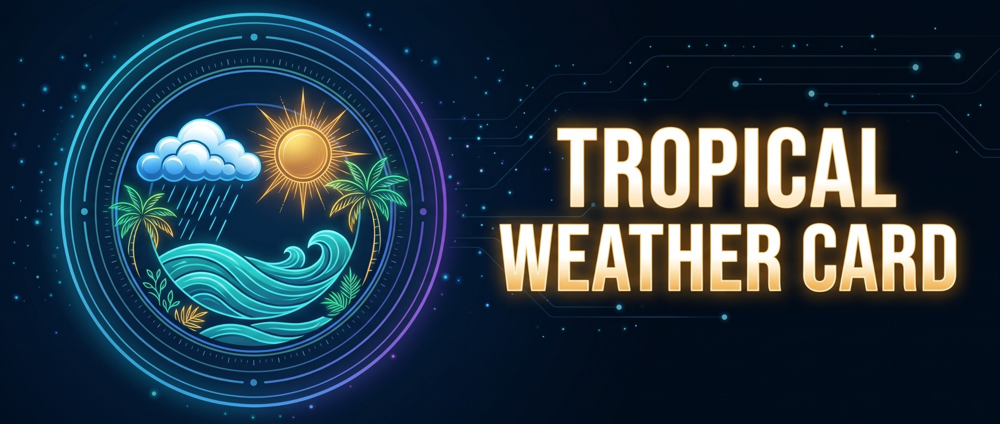
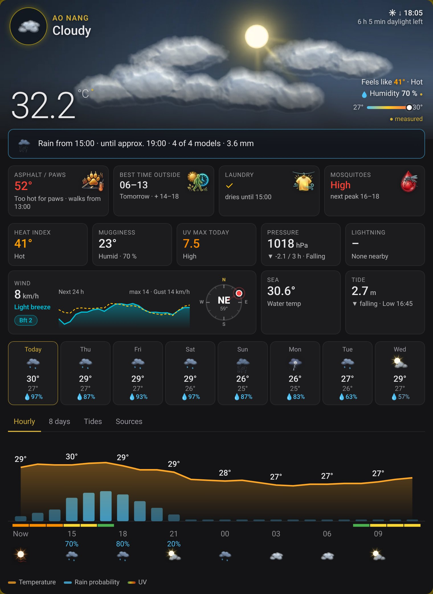
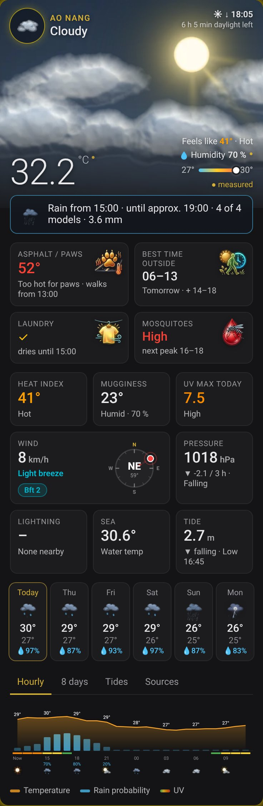
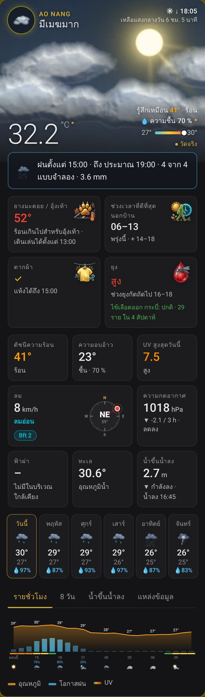
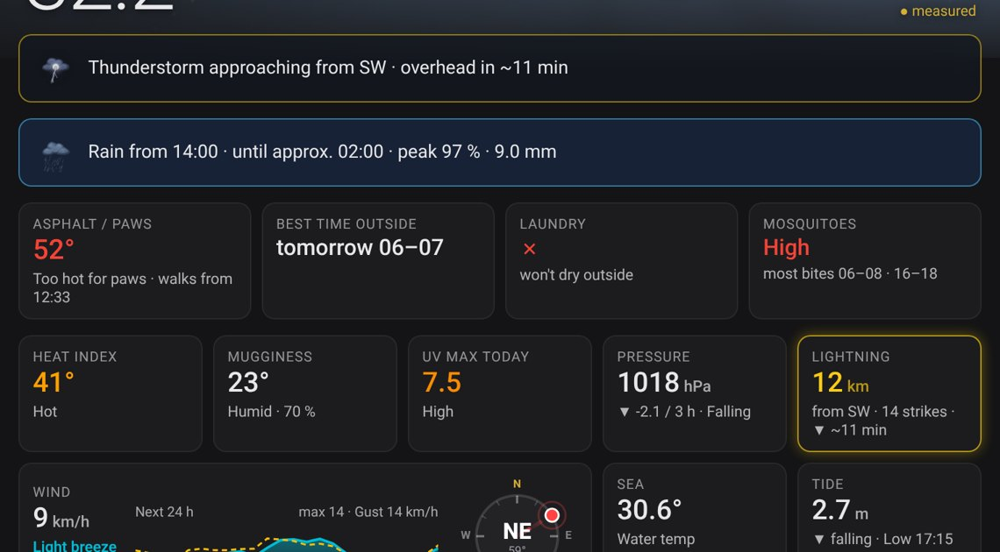

<p align="center">
  
</p>

<p align="center"><b>A Home Assistant weather card built for the tropics</b><br>
Monsoon downpours · heat stress · thunderstorms · cyclones · tides · and what the weather means for your day</p>

<p align="center">
  <a href="https://github.com/hacs/integration"></a>
  
  <a href="https://github.com/mb26-dev/ha-tropical-weather/releases"></a>
  
  <a href="https://ko-fi.com/mb26dev"></a>
</p>

Most weather cards are made for four seasons. In the tropics the questions are different: *Will the afternoon downpour hit before I get home? Is 35 °C feels-like normal today or dangerous? Is that thunderstorm coming towards us? Can the dog walk on the road yet? Will the laundry dry?*

**Tropical Weather Card** answers them in one card instead of a stack of five, using your weather integration plus the sensors you already have.

## Screenshots

<table>
  <tr>
    <td align="center" valign="top" width="58%">
      <br>
      <sub><b>Wide column</b> – sky scene, rain outlook, day planner, tropical tiles, wind compass with 24 h graph, week strip and hourly chart.</sub>
    </td>
    <td align="center" valign="top" width="21%">
      <br>
      <sub><b>Phone</b> – the layout adapts to the card width.</sub>
    </td>
    <td align="center" valign="top" width="21%">
      <br>
      <sub><b>Thai</b> – one of 19 languages.</sub>
    </td>
  </tr>
  <tr>
    <td colspan="3" align="center">
      <br>
      <sub><b>Thunderstorm tracking</b> – the card follows the strikes and tells you when the storm will be overhead.</sub>
    </td>
  </tr>
</table>

<sub>The screenshots use recorded data from Ao Nang, Thailand. The thunderstorm is simulated.</sub>

## Features

**Made for the tropics**
- **Climate-aware heat stress** – the heat index bands follow your latitude. 35 °C feels-like is *Normal* in Bangkok and *Extreme caution* in Berlin. Override with `climate:`.
- **Tropical conditions** – *Monsoon downpour* (≥ 12 mm/h), *Tropical heat* (UV ≥ 9 or feels-like above the hot band, daytime only) and *Tropical cyclone* replace the generic condition when they apply, with their own icons and sky scenes.
- **Rain outlook** – "Rain from 14:00 · until approx. 02:00 · peak 97 % · 9.0 mm" from the hourly forecast.
- **Mugginess** from the dew point, **UV max today**, **sea temperature** and **tide** (now, rising/falling, next high/low).

**Your day, planned**
- **Asphalt / paws** – estimated road surface temperature from air temperature, solar radiation and wind. Red above 52 °C (paw burns within a minute) with the time it is safe to walk again.
- **Best time outside** – the dry, cooler windows of the next hours, from dawn on, without thunderstorms.
- **Laundry** – does it dry outside today, until when, or not at all.
- **Mosquitoes** – Aedes (dengue) risk from temperature, humidity and recent and coming rain, with the peak biting times. Optionally the real dengue situation in your province from Thailand's national disease surveillance ([Mosquito Watch Thailand](https://github.com/mb26-dev/ha-dengue-watch)).

**Official warnings**
- **Warning banner** – shows the warnings of your national weather service on top of the card, coloured by severity (advisory, moderate, severe, extreme), with validity, instructions and a link to the bulletin. Works with CAP alert sensors (e.g. the [CAP Alerts](https://github.com/seevee/cap_alerts) integration with its WMO source, which includes TMD and many other national weather services), Meteoalarm, feedreader events and any sensor with a warning text. Filter it to your province or region with `alert_areas`.

**Thunderstorms and cyclones**
- **Storm approach** – with the [Blitzortung](https://github.com/mrk-its/homeassistant-blitzortung) integration the card tracks every strike and calculates whether the storm is approaching, passing or moving away: *"Thunderstorm approaching from SW · overhead in ~11 min"*.
- **30/30 rule** – after a strike within 10 km: *"Stay indoors until 17:42"*.
- **Cyclone alert** with name and distance from any cyclone sensor.

**Weather done properly**
- **Source check** – compares several weather integrations and your own sensors, so you see at a glance whether the models agree.
- **Local pressure** – a station pressure sensor is reduced to sea level with your elevation, plus the 3 h trend.
- **Wind compass** with Beaufort scale, gusts and a 24 h wind and gust graph.
- **Week strip** (8 days, 6 on phones), **hourly chart** with temperature, rain probability and UV, **8-day list**, **tide curve** and an optional **radar tab** that embeds any radar card you already use.
- **Animated icons and sky scenes** built in, plus an optional **photorealistic pack**.
- **19 languages**, picked automatically from your Home Assistant profile.

## Installation

### HACS (recommended)

[](https://my.home-assistant.io/redirect/hacs_repository/?owner=mb26-dev&repository=ha-tropical-weather&category=plugin)

1. Open **HACS** in Home Assistant, search for **Tropical Weather Card** and install it.
2. Reload the browser.

<details>
<summary>Not showing up in HACS yet? Add it as a custom repository</summary>

1. HACS → ⋮ → **Custom repositories** → add `https://github.com/mb26-dev/ha-tropical-weather`, type **Dashboard**.
2. Install **Tropical Weather Card** and reload the browser.

</details>

### Manual

1. Copy `dist/tropical-weather-card.js` to `/config/www/tropical-weather/`.
2. **Settings → Dashboards → ⋮ → Resources → Add resource**: `/local/tropical-weather/tropical-weather-card.js`, type **JavaScript module**.
3. Reload the browser.

## Configuration

The minimum is a weather entity. Add the card through the dashboard editor (search for *Tropical Weather Card*) or in YAML:

```yaml
type: custom:tropical-weather-card
weather: weather.home
```

A full example with every optional sensor:

```yaml
type: custom:tropical-weather-card
weather: weather.pirateweather
sources:                      # compared in the Sources tab
  - weather.pirateweather
  - weather.openweathermap
  - weather.forecast_home
temperature: sensor.outside_temperature
humidity: sensor.outside_humidity
pressure: sensor.outdoor_pressure
pressure_trend: sensor.pressure_change_3h
solar_radiation: sensor.pirateweather_downward_short_wave_radiation_flux
sea_temperature: sensor.sea_surface_temperature
tide: sensor.tide_extremes
lightning_distance: sensor.home_lightning_distance
lightning_counter: sensor.home_lightning_counter
lightning_azimuth: sensor.home_lightning_azimuth
cyclone: sensor.nearest_tropical_cyclone
observed_condition: input_select.sky_check   # what a camera sees right now
dengue: sensor.dengue_krabi_level            # Mosquito Watch Thailand
alerts:                       # official warnings banner
  - auto                      # every CAP alert sensor
  - event.latest_alerts_from_thai_meteorological_department_tmd
alert_areas: [TH-81, TH-83]   # ISO 3166-2 codes or area names
radar_card:
  type: custom:radarwise-card
  entity: weather.pirateweather
```

### Options

| Option | Default | Description |
|---|---|---|
| `weather` | **required** | Weather entity with hourly and daily forecasts. |
| `name` | location name | Title in the sky scene. |
| `sources` | `[weather]` | Weather entities compared in the *Sources* tab. |
| `temperature` / `humidity` | – | Your own outdoor sensors. They replace the model values in the header and the heat index. |
| `pressure` | – | Station pressure sensor; reduced to sea level with `elevation`. |
| `elevation` | HA elevation | Height above sea level in m for the pressure reduction. |
| `pressure_offset` | `0` | Correction in hPa added after the reduction. |
| `pressure_trend` | – | Sensor with the pressure change over 3 h in hPa. |
| `solar_radiation` | – | Global radiation in W/m². Without it the card models it from sun position and cloud cover. |
| `sea_temperature` | – | Sea surface temperature sensor. |
| `tide` | – | Sensor with a `predictions` attribute: list of `{time, height, type: high \| low}`. |
| `lightning_distance` / `lightning_counter` / `lightning_azimuth` | – | Blitzortung sensors for the lightning tile, storm approach and 30/30 rule. |
| `lightning_alert_km` | `15` | Distance for the lightning alert. |
| `cyclone` | – | Sensor whose state is the storm name and with a `distance_km` (or `distance`) attribute. |
| `cyclone_alert_km` | `400` | Distance at which a cyclone takes over the sky scene. |
| `rain_consensus` | `true` | The rain outlook, laundry and best-time tiles ask every weather entity in `sources`, not only the main one. A model counts as "rain" with a probability of 50 % or more, or with 0.3 mm or more when it gives no probability. The outlook shows how many models agree; the laundry tile only counts an hour as wet when more than half of the models agree. |
| `observed_condition` | – | An entity whose state is a weather condition seen right now (`sunny`, `partlycloudy`, `cloudy`, `rainy`, `pouring`, ...), for example an `input_select` filled from your outdoor cameras. For the current hour it overrules every model: hero condition (gold ● marker), rain outlook, laundry and best time. `unknown` or an old value is ignored. See [Observed weather from cameras](#observed-weather-from-cameras). |
| `observed_max_age` | `45` | Minutes after which `observed_condition` counts as outdated. |
| `dengue` | – | Dengue level sensor of [Mosquito Watch Thailand](https://github.com/mb26-dev/ha-dengue-watch). The mosquito tile then also shows the dengue situation in your province: *below normal*, *normal*, *elevated* or *high*, with the cases of the last 4 weeks. |
| `alerts` | – | Warning entities for the banner. `auto` adds every CAP alert sensor (an entity with `severity` and `geocodes` or `identifier`). Also accepts event entities (feedreader), Meteoalarm and plain sensors whose state is the warning. |
| `alert_areas` | – | Only show warnings whose `geocodes` or area description contain one of these codes or names (e.g. `TH-81`, `Krabi`). Warnings without area information are always shown. |
| `alert_min_severity` | `minor` | Lowest severity shown: `minor`, `moderate`, `severe` or `extreme`. Warnings without a severity count as `minor`. |
| `alert_max_age` | `24` | Hours an event entity (e.g. a feed item) stays visible when it has no expiry time. |
| `wind_gust` | weather attribute | Gust sensor in km/h; by default `wind_gust_speed` of the weather entity. |
| `radar_card` | – | Any card config; shown in the *Radar* tab. |
| `climate` | `auto` | Heat stress bands: `auto` (from latitude), `tropical`, `subtropical` or `temperate`. |
| `tropical_mode` | `true` | Monsoon, tropical heat and cyclone conditions. |
| `language` | `auto` | Language code, see below. `auto` uses your Home Assistant profile. |
| `show_week` | `true` | Week strip above the tabs. |
| `insights` | `true` | Day planner row (paws, best time, laundry, mosquitoes). |
| `show_hours` | `24` | Hours in the hourly chart. |
| `asset_path` | – | Folder with an alternative icon and background pack, see below. |

### Observed weather from cameras

Forecast models often expect rain while the sun is shining. If you have outdoor cameras and an AI Task entity (for example Google Gemini), Home Assistant can look outside and tell the card what is really happening:

1. Create an `input_select` helper **Sky Check** with the options `unknown`, `sunny`, `partlycloudy`, `cloudy`, `rainy`, `pouring`.
2. Add an automation that asks the AI every 15 minutes in daylight:

<details>
<summary>Automation (YAML)</summary>

```yaml
alias: Sky Check from Outdoor Cameras
triggers:
  - trigger: time_pattern
    minutes: /15
    id: check
  - trigger: numeric_state
    entity_id: sun.sun
    attribute: elevation
    below: 3
    id: night
actions:
  - choose:
      - conditions:
          - condition: trigger
            id: check
          - condition: numeric_state
            entity_id: sun.sun
            attribute: elevation
            above: 3
        sequence:
          - action: ai_task.generate_data
            data:
              entity_id: ai_task.google_ai_task
              task_name: sky check
              instructions: >-
                Outdoor camera images taken just now. Judge the weather at this moment only from
                what you see: sunlight and hard shadows mean sunny; some sun with patchy shadows
                means partlycloudy; soft light without shadows means cloudy; falling rain, rain
                streaks, splashes in puddles or drops on the lens mean rainy, heavy rain means
                pouring. A wet ground alone does not mean it is raining now.
              structure:
                condition:
                  required: true
                  selector:
                    select:
                      options: [sunny, partlycloudy, cloudy, rainy, pouring]
              attachments:
                - media_content_id: media-source://camera/camera.garden
                  media_content_type: image/jpeg
            response_variable: sky
            continue_on_error: true
          - action: input_select.select_option
            target:
              entity_id: input_select.sky_check
            data:
              option: "{{ sky.data.condition if sky is defined and sky.data is defined else 'unknown' }}"
      - conditions:
          - condition: trigger
            id: night
        sequence:
          - action: input_select.select_option
            target:
              entity_id: input_select.sky_check
            data:
              option: unknown
mode: single
```

</details>

3. Set `observed_condition: input_select.sky_check` on the card.

Cameras that only stream (RTSP, go2rtc) can be added as a *Generic Camera* with a still image URL such as `http://<go2rtc-host>:1984/api/frame.jpeg?src=<stream>`.

### Photorealistic pack

The card ships with animated vector icons. A photorealistic icon and sky pack is included in `dist/photoreal`. Copy that folder to `/config/www/tropical-weather/photoreal` and set:

```yaml
asset_path: /local/tropical-weather/photoreal
```

### Languages

English, Deutsch, ไทย, Tiếng Việt, Bahasa Indonesia, Bahasa Melayu, Filipino, ខ្មែរ, ລາວ, မြန်မာ, 简体中文, 繁體中文, 日本語, 한국어, हिन्दी, বাংলা, नेपाली, සිංහල, தமிழ்

Codes: `en de th vi id ms fil km lo my zh-Hans zh-Hant ja ko hi bn ne si ta`. Corrections from native speakers are very welcome – the strings are in [`src/i18n.js`](src/i18n.js).

## How the estimates work

- **Asphalt temperature**: air temperature + 0.033 × solar radiation, reduced by wind. Close to measured dark asphalt in full sun; it is a guide, not a measurement.
- **Solar radiation** (when no sensor is set): sun elevation from your coordinates, a clear-sky model (Haurwitz) and the forecast cloud cover (Kasten–Czeplak).
- **Storm approach**: a linear fit of the strike distances of the last 40 minutes. At least three strikes over six minutes are needed.
- **Laundry**: daylight hours (sun above 12°) without rain and below 92 % humidity. The current hour uses your own `humidity` sensor. Drying time depends on humidity: about 1.5 h below 65 %, 2.5 h below 80 %, otherwise 4 h. ✓ = enough time, ≈ = short window or rain close, ✗ = raining, dark or too humid.
- **Dengue** (with the `dengue` option): reported cases of the last 4 weeks against the 5-year median of the same weeks, from the Report 506 surveillance of the Department of Disease Control.
- **Mosquito risk**: a simple index of mean temperature (26–32 °C is ideal for Aedes), humidity and rain in the next two days. It shows conditions, not actual mosquito counts.

## Development

The card is plain JavaScript without a build toolchain. `src/card.src.js` holds the card, `src/i18n.js` the translations. `python build.py` combines them into `dist/tropical-weather-card.js`.

## License

MIT – see [LICENSE](LICENSE).
